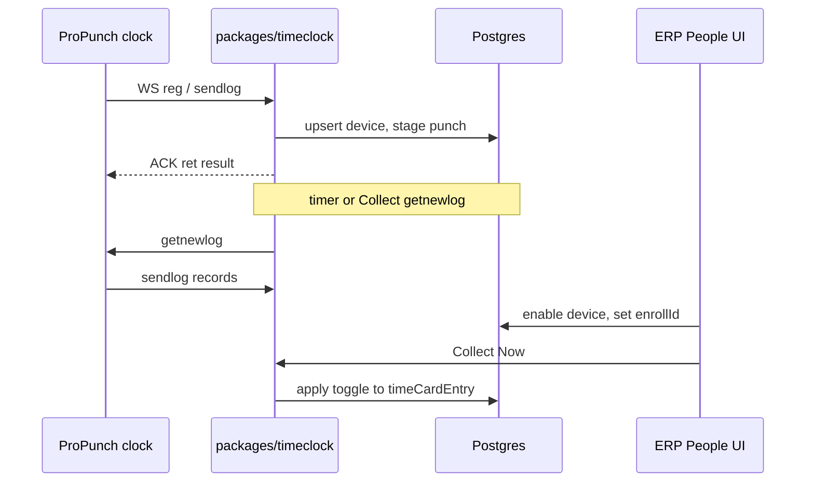

# ProPunch Hardware Timeclock Integration

> Status: draft
> Author: agent + nturpin
> Date: 2026-10-12

## TLDR

Add a Carbon-owned ProPunch / FPC18 gateway (`packages/timeclock`) on port 7788. Add a People → Timeclocks admin page. Clocks push punches. Admins run Collect and a gateway poll timer. Raw punches stage into `timeClockPunch`. When the device is enabled and `employeeJob.enrollId` matches, Carbon toggles open/close on `timeCardEntry`.

## Overview diagram



## Problem Statement

Carbon already tracks attendance with `timeCardEntry` in ERP Timecards and MES. It has no hardware punch path. ProPunch / FPC18 clocks open outbound WebSocket JSON to `ws://ServerIP:7788/pub/chat`. Without a Carbon gateway and admin UI, the fork cannot import punches from those clocks.

## Proposed Solution

1. Ship `@carbon/timeclock`: listen on `TIMECLOCK_HOST`:`TIMECLOCK_PORT` (default `0.0.0.0:7788`), path `/pub/chat`, plus HTTP control for Collect.
2. On `reg`, upsert `timeClockDevice` for `TIMECLOCK_COMPANY_ID`. ACK with `cloudtime`. Never soft-reset the clock in v1.
3. On `sendlog`, stage each record into `timeClockPunch` (idempotent). ACK always.
4. If the device is enabled and `enrollid` maps to `employeeJob.enrollId`, toggle `timeCardEntry` (open → clock out; else clock in).
5. People → Timeclocks lists devices, online status, enable, poll interval, Collect Now, and unmapped punches.
6. Gateway timer polls enabled devices with `getnewlog` when auto-poll is on.

Research: `.ai/research/propunch-timeclock.md`. Protocol brief: copy agent-store `acroprint-fpc18-websocket-protocol.md` into the repo under `docs/`.

### Design Decisions

| Decision | Choice | Rationale |
|----------|--------|-----------|
| Network gateway | Option A — `packages/timeclock` owns WS 7788 | Clean ownership; no `WSS.exe` |
| Admin UI | People → Timeclocks | Same module as Timecards; ADP/UKG pattern |
| Tenant v1 | Single company via `TIMECLOCK_COMPANY_ID` env | User scope for v1; rows still store `companyId` |
| Enroll id | `employeeJob.enrollId` (unique per company when set) | SAP/ADP badge-on-employee; simple MVP |
| Punch → interval | Toggle open/close; ignore `inout` | Punch-and-go; defer soft keys |
| Unknown enroll id | Stage + ACK; repair in UI | Do not lose device buffers or audit trail |
| Device create | Auto on `reg`; must enable before applying to `timeCardEntry` | UKG auto-reg then configure |
| Polling | Gateway timer + Collect Now → `getnewlog` | Pull lives on the socket process |
| Soft reset | Never in v1 | Protect on-device enrollments |
| Enroll/biometric sync | Out of scope v1 | Punch ingest first |
| Gateway config | Env: company id, host, port | Matches single-company LAN sidecar |
| Multi-tenancy | Every new table has `companyId` + composite PK | Carbon convention |
| Service shape | `{ data, error }`; client first where ERP services | People module conventions |
| RLS | Authz manifest `people_*` like `timeCardEntry` | Same permission family |
| Permissions | `people_view` / `create` / `update` / `delete` | Feature lives in people |
| Forms | `ValidatedForm` + `validator(zod)` | Form conventions |
| Module layout | Device/punch services in people; gateway in `@carbon/timeclock` | UI in people; I/O isolated |
| Backward compatibility | Additive schema and routes | No change to existing MES/ERP software clock |
| Default auto-poll | Off until admin enables per device | Avoid surprise device traffic |
| Gateway DB access | Service-role client inside `@carbon/timeclock` ingest | Same pattern as jobs writers |

## Data Model Changes

### `employeeJob.enrollId`

Nullable text. Unique when set: `(companyId, enrollId)`. Edit on the person / job form.

### `timeClockDevice`

```sql
CREATE TABLE "timeClockDevice" (
  "id" TEXT NOT NULL DEFAULT id('tcd'),
  "companyId" TEXT NOT NULL,
  "serialNumber" TEXT NOT NULL,
  "name" TEXT,
  "enabled" BOOLEAN NOT NULL DEFAULT FALSE,
  "autoPoll" BOOLEAN NOT NULL DEFAULT FALSE,
  "pollIntervalSeconds" INTEGER NOT NULL DEFAULT 300,
  "lastSeenAt" TIMESTAMP WITH TIME ZONE,
  "lastRegAt" TIMESTAMP WITH TIME ZONE,
  "firmware" TEXT,
  "modelName" TEXT,
  "createdBy" TEXT NOT NULL REFERENCES "user"("id"),
  "createdAt" TIMESTAMP WITH TIME ZONE NOT NULL DEFAULT NOW(),
  "updatedBy" TEXT REFERENCES "user"("id"),
  "updatedAt" TIMESTAMP WITH TIME ZONE,
  PRIMARY KEY ("id", "companyId"),
  FOREIGN KEY ("companyId") REFERENCES "company"("id") ON DELETE CASCADE
);
CREATE INDEX "timeClockDevice_companyId_idx" ON "timeClockDevice" ("companyId");
ALTER TABLE "timeClockDevice" ADD CONSTRAINT "timeClockDevice_companyId_serialNumber_key"
  UNIQUE ("companyId", "serialNumber");
```

Gateway `reg` upserts by `(companyId, serialNumber)`. System actor for `createdBy` when auto-created.

### `timeClockPunch`

```sql
CREATE TABLE "timeClockPunch" (
  "id" TEXT NOT NULL DEFAULT id('tcp'),
  "companyId" TEXT NOT NULL,
  "deviceId" TEXT NOT NULL,
  "serialNumber" TEXT NOT NULL,
  "enrollId" TEXT NOT NULL,
  "punchedAt" TIMESTAMP WITH TIME ZONE NOT NULL,
  "inout" INTEGER,
  "event" INTEGER,
  "mode" INTEGER,
  "raw" JSONB NOT NULL,
  "status" TEXT NOT NULL DEFAULT 'pending',
  "employeeId" TEXT,
  "timeCardEntryId" TEXT,
  "error" TEXT,
  "createdAt" TIMESTAMP WITH TIME ZONE NOT NULL DEFAULT NOW(),
  PRIMARY KEY ("id", "companyId"),
  FOREIGN KEY ("companyId") REFERENCES "company"("id") ON DELETE CASCADE,
  FOREIGN KEY ("deviceId", "companyId") REFERENCES "timeClockDevice"("id", "companyId") ON DELETE CASCADE
);
-- status: pending | applied | unmapped | duplicate | error
-- Idempotency (unique when all present):
ALTER TABLE "timeClockPunch" ADD CONSTRAINT "timeClockPunch_idempotency_key"
  UNIQUE ("companyId", "serialNumber", "enrollId", "punchedAt", "mode", "event");
```

Authz: register both tables under `people_*` in the authz manifest (same pattern as `timeCardEntry`).

## API / Service Changes

### `@carbon/timeclock`

- WebSocket `/pub/chat`: handle `reg`, `sendlog`; send `getnewlog` on Collect / timer.
- HTTP: Collect Now, device online map, health.
- Ingest: stage each punch. If the device is enabled and enroll id maps, toggle `timeCardEntry` through a shared helper (service role).
- Env: `TIMECLOCK_COMPANY_ID`, `TIMECLOCK_HOST`, `TIMECLOCK_PORT`, DB URL / service role.
- Optional: `crbn up` starts the process when `TIMECLOCK_COMPANY_ID` is set.

### People module (ERP)

- CRUD helpers for devices; list punches by status; set `enrollId` on `employeeJob`.
- Actions: enable/disable, auto-poll, Collect Now (HTTP to gateway), reprocess unmapped after mapping.
- Routes under `x+/people+/timeclocks*` (exact paths in plan).
- Gate nav with `timeCardEnabled`.

### Out of scope v1

- `setuserinfo` / `senduser` / biometric template sync.
- Soft reset (`initsys` / `cleanuser` / `cleanlog`).
- Multi-company gateway routing.
- Honoring `inout` / break `event` codes on intervals.
- Door / lock commands.

## UI Changes

- People submodule **Timeclocks** next to Timecards.
- Table: serial, name, enabled, online/last seen, auto-poll, actions (Collect, Enable).
- Device detail or drawer: poll interval, recent punches, unmapped count.
- Person / job: **Enroll ID** field.
- Unmapped punches panel: enroll id, time, link to set enroll id / reprocess.
- Setup copy: set clock Server Setting Yes, Server IP = gateway host, SerPortNo **7788**, firewall TCP 7788.

## Acceptance Criteria

- [ ] With `TIMECLOCK_COMPANY_ID` set, the gateway listens on 7788 `/pub/chat` and ACKs `reg` without wiping the clock.
- [ ] A first `reg` creates a disabled `timeClockDevice` for that company and serial.
- [ ] After enable + `employeeJob.enrollId`, the first matching `sendlog` punch sets `clockIn` on a new `timeCardEntry`.
- [ ] The second matching punch sets `clockOut` on that open entry.
- [ ] An unknown enroll id punch is stored as `unmapped`, still ACK’d, and shown on Timeclocks.
- [ ] After the admin maps enroll id and reprocesses, that punch applies.
- [ ] Duplicate identical punch payloads do not create a second `timeCardEntry` toggle (idempotent unique key).
- [ ] Collect Now triggers `getnewlog` for the selected enabled online device.
- [ ] Enabling auto-poll on a device causes the gateway timer to call `getnewlog` on that interval.
- [ ] People → Timeclocks is hidden when `timeCardEnabled` is false.
- [ ] Users without `people_view` cannot load Timeclocks; enable/Collect require `people_update`.

## Risks

| Risk | Severity | Mitigation |
|------|----------|------------|
| Plain `ws://` and sn-only identity | High | LAN-only deploy; document; single-company env |
| Toggle ignores In/Out soft keys | Med | Document; later honor `inout` |
| Service-role gateway writes | Med | Narrow ingest functions; no broad admin API on 7788 |
| Clock pointed at wrong Server IP | Med | Setup docs; online status on Timeclocks |
| Port 7788 conflict with leftover `WSS.exe` | Med | Document stop Acroprint gateway before start |

## Open Questions

All resolved before this file was written:

- [x] Gateway process — **Answer:** Option A, `packages/timeclock`
- [x] Admin UI location — **Answer:** People → Timeclocks
- [x] Company binding v1 — **Answer:** Single company via env `TIMECLOCK_COMPANY_ID`
- [x] Enroll id storage — **Answer:** `employeeJob.enrollId`
- [x] Punch pairing — **Answer:** Toggle; ignore `inout` in v1
- [x] Polling — **Answer:** Gateway timer + Collect Now → `getnewlog`
- [x] Unknown enroll id — **Answer:** Stage + ACK; repair UI
- [x] Device rows — **Answer:** Auto on `reg` + must enable
- [x] Enroll/biometric sync — **Answer:** Out of scope v1
- [x] Gateway config — **Answer:** Env (company id, host, port)
- [x] Soft reset on first `reg` — **Answer:** Never in v1
- [x] Monorepo location — **Answer:** `packages/timeclock`

## Changelog

- 2026-10-12: Created after grill; research `.ai/research/propunch-timeclock.md`
